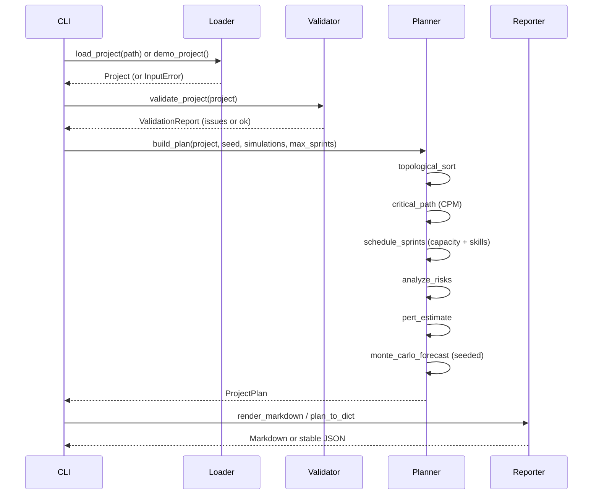
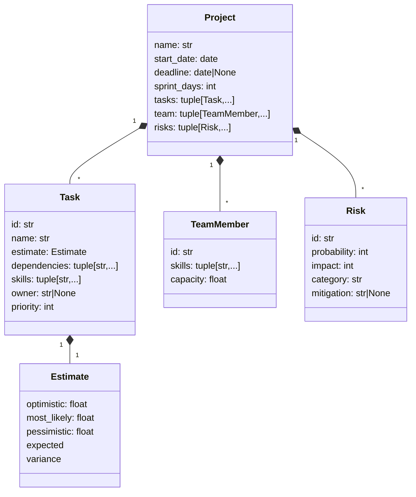

# Architecture

## Goals

1. **Credible planning science.** Implement the algorithms a PM/TPM actually
   uses — dependency ordering, CPM float, PERT, capacity levelling, risk scoring,
   Monte Carlo — not a prompt wrapper.
2. **Offline and reproducible.** Standard library only; fixed seeds; stable ID
   tie-breaks; no network, database, model, or credential in the runtime path.
3. **Explainable failure.** Validation aggregates issues with stable codes; the
   CLI returns exit code `2` and a readable message.
4. **Preserve the research.** The original CrewAI/FastAPI/Trello work remains in
   `src/` as an optional agentic layer.

## Package layout

| Module | Responsibility |
| --- | --- |
| `models.py` | Frozen dataclasses (`Project`, `Task`, `TeamMember`, `Risk`, `Estimate`) and strict JSON parsing |
| `issues.py` | `Issue(code, message, subject)` validation finding |
| `exceptions.py` | `ProjectAdvisorError`, `InputError`, `ValidationError` |
| `validation.py` | Invariant checks, `ValidationReport`, `load_project` |
| `schedule.py` | Kahn topological sort, CPM forward/backward passes, critical path |
| `capacity.py` | Greedy sprint allocation with skills, owner preference, overload and spillover |
| `risk.py` | Probability × impact scoring, heat-map buckets, mitigation defaults |
| `forecast.py` | PERT, working-day helpers, seeded Monte Carlo |
| `plan.py` | Composition (`build_plan`) and stable JSON (`plan_to_dict`) |
| `report.py` | Executive Markdown renderer |
| `demo.py` | Deterministic 13-task Atlas scenario |
| `cli.py` / `__main__.py` | argparse interface and `python -m project_advisor` |

## Data flow



## Domain model



All four core dataclasses are frozen and slotted. Mapping/list inputs are copied
into tuples; the project itself is never mutated.

## Algorithms

### Validation

`validate_project` checks project, task, member, and risk invariants and returns
every finding. Graph checks are delegated to `topological_sort`, which raises
`ValidationError` with unknown-dependency or cycle issues. Duplicate task IDs
suppress graph checks so the report does not cascade.

### Topological sort and CPM

Kahn's algorithm with a min-heap over task IDs gives a deterministic order. For
each task in that order:

```
ES(t)   = max(EF(dep) for dep in deps(t)), default 0
EF(t)   = ES(t) + PERT(t)
total   = max(EF(t))
LF(t)   = min(LS(child) for child in successors(t)), default total
LS(t)   = LF(t) - PERT(t)
slack   = LS(t) - ES(t)
critical = |slack| <= 1e-9
```

The critical path is recovered by starting at the critical task with the greatest
earliest finish and walking backwards through predecessors whose finish equals
the current earliest start. Ties break on ID.

### PERT

```
expected(t) = (o + 4m + p) / 6
variance(t) = ((p - o) / 6)^2
project variance = sum(variance on critical path)
```

Optimistic and pessimistic project durations are longest paths using the
corresponding point estimates.

### Capacity-constrained sprint allocation

For each sprint up to the horizon:

1. Compute dependency-ready tasks (all dependencies completed).
2. Order by `(priority, id)`.
3. For each task, keep its existing owner across sprints; otherwise choose an
   eligible member (all required skills) with remaining capacity, preferring the
   named owner, then the most remaining capacity, then member ID.
4. Assign `min(remaining_effort, member_capacity_left)`. A task completes when its
   cumulative effort is exhausted.
5. Record blocked tasks (no available member/capacity), overloaded sprints
   (ready demand exceeds supply, or work is blocked by capacity), and skill gaps.
6. Stop when every task is complete or a sprint makes no assignment.

The default horizon is capacity-aware: `max(1, task_count,
ceil(total_effort / total_capacity) + task_count)`. The scheduler reports
spillover when a task starts later than `1 + max(finish sprint of dependencies)`.

This is a greedy heuristic. It is intentionally explainable and does not claim
global optimality.

### Risk

```
score  = probability (1-5) * impact (1-5)
bands  = <=4 low, <=9 medium, <=15 high, >15 critical
```

Risks sort by score descending then ID. Explicit mitigations override
category defaults (`technical`, `schedule`, `resource`, `scope`, `quality`,
`external`, generic fallback). Exposure is the sum of scores; `highest_bucket`
walks the bands from critical down to low.

### Monte Carlo

Each simulation samples every task from
`random.triangular(optimistic, pessimistic, most_likely)` using a local
`random.Random(seed)`, then computes the longest path through the DAG. Percentiles
use nearest-rank on sorted samples. With a deadline, the on-time probability is
the share of samples whose duration is at most the number of inclusive weekdays
between start and deadline.

### Reporting

The Markdown report exposes only computed values: WBS with float and critical
flags, critical path, sprint assignments, capacity signals, risk heat map, and
the forecast table with indicative finish dates. `plan_to_dict` mirrors the same
data with rounded floats and sorted JSON keys at serialisation time.

## Determinism contract

- Task ties → task ID; member ties → member ID; risk ties → risk ID.
- Monte Carlo → explicit seed; one local RNG; no global random state.
- JSON → `json.dumps(sort_keys=True)` in the CLI; tuple/list order follows the
  input WBS or explicit analysis order.
- No `datetime.now`, filesystem discovery, locale-dependent formatting, or
  network calls in the engine.

## Error handling

| Condition | Behaviour |
| --- | --- |
| Wrong JSON shape/type | `InputError`; CLI exit 2 |
| Invalid JSON syntax | `InputError`; CLI exit 2 |
| Unreadable file | `OSError`; CLI prints a read error and exits 2 |
| Planning invariant violation | `ValidationError` with all issues; CLI exit 2 |
| Invalid `--sprints` / `--simulations` | `InputError`; CLI exit 2 |
| Bad CLI arguments | argparse usage error; exit 2 |

## Boundary with the agentic prototype

`src/automated_project_planning/`, `src/intelligent_project_analysis/`,
`src/inventory_management_sales_forecast/`, and `src/app/` are the original
CrewAI/FastAPI experiments. They are preserved but never imported by
`project_advisor` or its tests. They require optional services (Ollama, Trello,
Postgres) and are not part of the deterministic delivery path.

## Extension points

- Add an exporter (Jira, Trello, CSV) by consuming `ProjectPlan` or
  `plan_to_dict`; no algorithm changes required.
- Add holidays by extending `add_working_days`/`working_days_available` with a
  calendar set.
- Add resource levelling or an ILP optimiser behind the same `CapacityPlan` shape.
- Add cost fields to `Task`/`TeamMember` and extend the report.
- Replace triangular sampling with empirical distributions while keeping the
  `ForecastResult` contract.

## Performance

The algorithms are polynomial in tasks plus edges; Monte Carlo is
`O(simulations * (tasks + edges))`. The default demo (13 tasks, 1,000 simulations)
runs in well under a second on a laptop-class machine. No caching is needed at
this scale.
