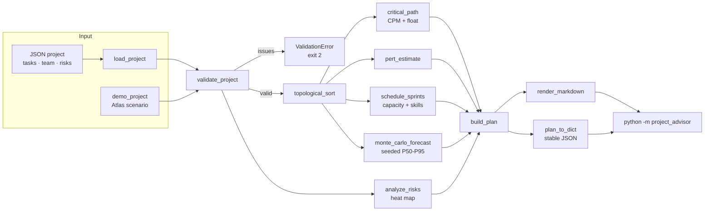

# APAMA — Agentic Project Agnostic Management Advisor

**A deterministic project-management decision engine wrapped in an agentic research prototype.**

[](https://www.python.org/)
[](#measured-results)
[](#measured-results)
[](#engineering-decisions)
[](license.txt)

APAMA answers a question every delivery team faces: **given tasks, dependencies,
skills, sprint capacity, risks, and a deadline, what is the most defensible plan
we can produce today — and how uncertain is it?**

The answer is not an LLM opinion. It is a reproducible plan built from the
Critical Path Method, PERT, seeded Monte Carlo simulation, a risk heat map, and a
capacity-constrained sprint allocator. The original CrewAI notebooks and FastAPI
prototype remain in the repository as the agentic research layer; the new
`project_advisor/` package is the runnable engineering core. It uses **only the
Python standard library**.

```console
$ python3 -m project_advisor --demo
# Executive delivery plan: Atlas Release Readiness
...
Expected duration (CPM) ............ 46.8 person-days
Monte Carlo P50 / P80 ............. 49.4 / 52.3 days
On-time probability ............... 100%
Risk exposure ..................... 80 (highest: critical)
Sprint capacity plan .............. feasible
```

---

## The problem

Most project plans fail in the seams:

- dependencies are implicit, so the real critical path is discovered late;
- estimates are single numbers, so uncertainty is hidden until it becomes delay;
- capacity is assumed to be infinite, so "planned" work spills into future sprints;
- risks are listed but never scored consistently or tied to mitigations;
- dashboards disagree because every report recomputes numbers differently.

APAMA makes those seams explicit. It validates the work breakdown, computes float
and the critical path, allocates whole tasks to named people under skill and
capacity constraints, scores risks on a 5×5 matrix, and forecasts a completion
distribution with a fixed seed. The Markdown and JSON outputs are deterministic,
which means a plan can be reviewed, diffed, and regression-tested like code.

## What it does

| Capability | Implementation |
| --- | --- |
| Work Breakdown Structure | Typed `Task`, `TeamMember`, `Risk`, and `Project` models with three-point estimates |
| Validation | Duplicate IDs, unknown dependencies, cycles, negative/non-finite estimates, impossible deadlines, bad priorities/capacities/risk scales |
| Dependency planning | Deterministic Kahn topological sort with stable ID tie-breaks |
| Critical Path Method | Forward/backward passes, earliest/latest start and finish, float, critical path |
| Sprint allocation | Skill-constrained greedy scheduling with owner preference, multi-sprint tasks, overload, spillover, and skill-gap detection |
| Risk register | Probability × impact scoring, low/medium/high/critical heat-map buckets, category-based mitigation suggestions |
| PERT | Expected duration and critical-path variance |
| Forecasting | Seeded triangular Monte Carlo with P50/P80/P90/P95 and deadline probability |
| Reporting | Executive Markdown report and stable, sorted JSON |
| CLI | `python -m project_advisor` with `--demo`, `--json`, `--sprints`, `--seed`, `--simulations` |

## Architecture



The deterministic engine has **no imports outside the standard library**. The
optional prototype in `src/` (CrewAI agents, Ollama, Trello, FastAPI, Postgres)
is not required to run, test, or evaluate the decision engine.

## Repository map

```
.
├── project_advisor/            # New deterministic engine (stdlib only)
│   ├── models.py               # Domain dataclasses + JSON deserialisation
│   ├── issues.py               # Validation finding type
│   ├── exceptions.py           # InputError / ValidationError
│   ├── validation.py           # Invariant checks + project loader
│   ├── schedule.py             # Topological sort + CPM
│   ├── capacity.py             # Skill/capacity-constrained sprint allocation
│   ├── risk.py                 # Risk scoring, buckets, mitigations
│   ├── forecast.py             # PERT + seeded Monte Carlo + working days
│   ├── plan.py                 # Plan composition + stable JSON
│   ├── report.py               # Executive Markdown renderer
│   ├── demo.py                 # Atlas demo scenario
│   ├── cli.py                  # argparse CLI
│   └── __main__.py             # python -m project_advisor
├── tests/test_project_advisor.py
├── docs/DESIGN_DECISIONS.md
├── .github/workflows/ci.yml
├── src/                        # Original CrewAI notebooks, configs, FastAPI app
│   ├── automated_project_planning/
│   ├── intelligent_project_analysis/
│   ├── inventory_management_sales_forecast/
│   └── app/
├── data/ · research/           # Original research and data artefacts
├── ARCHITECTURE.md
├── TESTING.md
├── CONTRIBUTING.md
├── Makefile
├── pyproject.toml
└── license.txt
```

## Quickstart

No third-party runtime packages are needed.

```bash
git clone https://github.com/MrKyaw/Agentic-Project-Agnostic-Management-Advisor.git
cd Agentic-Project-Agnostic-Management-Advisor

python3 -m venv .venv
source .venv/bin/activate
python -m pip install -e ".[dev]"   # pytest + coverage only

python -m pytest -q
python -m project_advisor --demo
```

The demo prints an executive report for a 13-task, 7-person release with seven
scored risks. On this machine it completes in well under a second.

### CLI examples

```bash
# Human-readable executive plan for the built-in scenario
python -m project_advisor --demo

# Machine-readable, stable JSON (sorted keys)
python -m project_advisor --demo --json > plan.json

# Plan your own project, cap the sprint horizon, fix the forecast seed
python -m project_advisor project.json --sprints 8 --seed 7

# Faster forecast while iterating
python -m project_advisor project.json --simulations 250

python -m project_advisor --help
```

Exit codes: `0` success, `2` invalid input, invalid project, unreadable file, or
argument error. Validation reports every issue it can find rather than failing on
the first one.

### Project JSON

Only `name`, `start_date`, and `tasks` are required. Durations and capacities are
person-days; `priority` is 1 (highest) to 5 (lowest).

```json
{
  "name": "Payments migration",
  "start_date": "2026-01-05",
  "deadline": "2026-03-31",
  "sprint_days": 10,
  "tasks": [
    {
      "id": "DESIGN",
      "name": "Target architecture",
      "estimate": {"optimistic": 3, "most_likely": 5, "pessimistic": 9},
      "dependencies": [],
      "skills": ["architecture"],
      "owner": "arch",
      "priority": 1
    },
    {
      "id": "BUILD",
      "name": "Implement migration",
      "estimate": {"optimistic": 8, "most_likely": 13, "pessimistic": 20},
      "dependencies": ["DESIGN"],
      "skills": ["backend"],
      "priority": 1
    }
  ],
  "team": [
    {"id": "arch", "name": "Ravi", "skills": ["architecture"], "capacity": 8},
    {"id": "be", "name": "Aisha", "skills": ["backend"], "capacity": 9}
  ],
  "risks": [
    {
      "id": "R1",
      "title": "Legacy schema differs from documentation",
      "probability": 4,
      "impact": 5,
      "category": "technical",
      "owner": "arch"
    }
  ]
}
```

### Python API

```python
from project_advisor import build_plan, load_project, render_markdown

project = load_project("project.json")
plan = build_plan(project, simulations=2000, seed=7, max_sprints=10)

print(render_markdown(plan))
print(plan.schedule.critical_path)
print(plan.schedule.duration)
print(plan.capacity.overloaded_sprints, plan.capacity.spillover)
print(plan.forecast.percentiles[80], plan.forecast.on_time_probability)
```

Every analysis is also callable independently: `validate_project`,
`topological_sort`, `critical_path`, `schedule_sprints`, `analyze_risks`,
`pert_estimate`, `monte_carlo_forecast`, `plan_to_dict`, `render_markdown`.

## Measured results

Measured on Python 3.12.8 / macOS, 2026-10-22, with no network access:

```console
$ python3 -m pytest -q
142 passed in 0.33s
```

```console
$ python3 -m pytest --cov=project_advisor --cov-branch --cov-report=term-missing
Name                            Stmts   Miss Branch BrPart  Cover
-------------------------------------------------------------
project_advisor/__init__.py        12      0      0      0 100.00%
project_advisor/__main__.py         2      0      0      0 100.00%
project_advisor/capacity.py       118      0     26      0 100.00%
project_advisor/cli.py             41      0      6      0 100.00%
project_advisor/demo.py             9      0      0      0 100.00%
project_advisor/exceptions.py      10      0      0      0 100.00%
project_advisor/forecast.py        91      0     24      0 100.00%
project_advisor/issues.py           7      0      0      0 100.00%
project_advisor/models.py         118      0     16      0 100.00%
project_advisor/plan.py            29      0      0      0 100.00%
project_advisor/report.py          71      0     24      0 100.00%
project_advisor/risk.py            46      0     12      0 100.00%
project_advisor/schedule.py       107      0     36      0 100.00%
project_advisor/validation.py      82      0     48      0 100.00%
-------------------------------------------------------------
TOTAL                             743      0    192      0 100.00%
142 passed
```

The coverage gate is enforced at `fail_under = 100` in `pyproject.toml` and in CI
across Python 3.10, 3.11, and 3.12. The reported runtime is from the
non-coverage run shown above. No coverage exclusions or `# pragma: no cover`
directives are used in the runtime package.

## Engineering decisions

- **Standard library only.** A recruiter or reviewer can run the engine with a
  stock Python interpreter. No install, API key, model download, or database.
- **Deterministic before stochastic.** Topological ties break on task ID, member
  ties break on member ID, and Monte Carlo uses an explicit seed. Identical input
  produces identical Markdown and JSON.
- **Validate first, explain everything.** The loader checks JSON shape; the
  validator aggregates planning invariants into stable issue codes. The CLI exits
  with `2` and a readable message rather than a traceback.
- **CPM is computed on effort, capacity is computed on people.** The CPM answers
  "how long is the dependency chain?"; the sprint allocator answers "who can
  actually do it, and when?". They are deliberately separate views.
- **Tasks have one owner but may span sprints.** This avoids the fantasy of
  splitting a 13-day task across three people in one sprint while keeping the
  algorithm explainable.
- **Risk scoring is multiplicative.** Probability × impact on 5×5 scales maps to
  four heat-map bands and a deterministic mitigation default per category.
- **Stable JSON is a contract.** `plan_to_dict` emits sorted, rounded values with
  no set ordering, so plans can be diffed in code review or snapshot-tested.
- **The prototype is preserved.** CrewAI configs, notebooks, FastAPI app, data,
  and license remain untouched. The deterministic engine is the evaluation path;
  the agentic layer is the research context.

## Honest limitations

- **Not a solver.** Sprint allocation is greedy and priority-ordered. It reports
  overload and spillover but does not optimise globally (no ILP or constraint
  programming).
- **Simple calendar.** Dates skip weekends, not public holidays, leave, or
  part-time patterns. `sprint_days` is metadata; capacity is the binding input.
- **Independence assumptions.** PERT sums critical-path variances and Monte Carlo
  samples tasks independently. Correlated risks or shared blockers need a custom
  model.
- **Effort, not cost.** There is no budget, earned value, or resource cost model.
- **One skill set per task.** A task requires every listed skill from a single
  owner; cross-functional pairing is not modelled.
- **JSON in, reports out.** There is no Jira/Trello/Postgres exporter in the
  deterministic package. The original FastAPI/Trello paths in `src/` are optional
  prototypes and are not exercised by the test suite.
- **Live agent paths are optional.** CrewAI, Ollama, Trello, and Postgres require
  credentials/services and are intentionally outside the offline runtime and CI.
- **Forecast model choice.** Monte Carlo uses triangular distributions over
  `(optimistic, pessimistic, most likely)`; this is transparent but not a
  substitute for calibrated historical data.

## Recruiter snapshot

**Who this is for:** project/programme management, technical program management,
platform engineering, and applied-AI roles where planning rigour matters.

**What it demonstrates:**

- translating messy PM practice into typed domain models and explicit invariants;
- implementing classical planning algorithms (topological sort, CPM, PERT,
  seeded Monte Carlo) rather than wrapping an LLM call;
- capacity and skill constraints with honest overload/gap reporting;
- test engineering: 142 tests, 100% line and branch coverage, deterministic
  fixtures, CLI error paths, and a coverage gate in CI;
- professional packaging: `pyproject.toml`, Makefile, GitHub Actions matrix,
  architecture and testing docs, and a clean stdlib-only runtime.

**30-second tour:** run `python -m project_advisor --demo`, open the report, then
read `project_advisor/capacity.py` and `tests/test_project_advisor.py`. The demo
shows the output; the tests show the engineering standard.

## Original agentic prototype

The repository began as the Agentic Project Agnostic Management Advisor (APAMA):
CrewAI crews for planning, estimation, resource allocation, Trello progress
analysis, and inventory/sales forecasting, plus a FastAPI + Postgres backend.
Those notebooks and configs remain in `src/` for reference. They are optional:
the deterministic advisor does not import CrewAI, Ollama, Trello, FastAPI, or any
database driver, and the test suite never touches the network.

See `src/readme.md` for the original environment setup.

## Author

**Kyaw Kyaw Oo**
[kyaw.tech@gmail.com](mailto:kyaw.tech@gmail.com) · [github.com/MrKyaw](https://github.com/MrKyaw)

## License

MIT — see [license.txt](license.txt).
